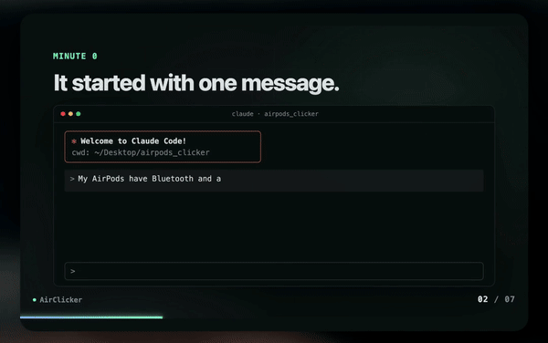
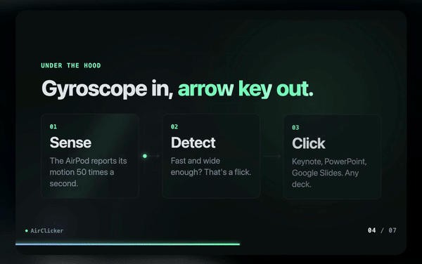
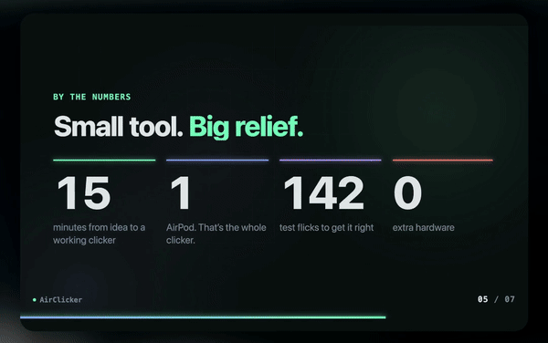

# AirClicker

**Flick an AirPod. Change the slide.** Hold one AirPod and flick your wrist: right for the next slide, left to go back.

[](#requirements) [](Sources/AirClicker/main.swift) [](LICENSE) [](https://claude.com/claude-code)

[Install](#install-it-with-an-ai-agent) · [Features](#features) · [A look inside](#a-look-inside) · [How it works](#how-it-works) · [Privacy](#privacy)

<p align="center"></p>

AirClicker is a tiny macOS menu bar app. It reads the motion sensors in your AirPods, spots a quick wrist flick, and presses the arrow key for you. No extra hardware, no phone app.

It started as a 15 minute build with [Claude Code](https://claude.com/claude-code) on the morning of a presentation, and was then tuned on 159 logged test flicks.

## Features

- **Flick to change slides.** Right for next, left for back, with one AirPod held between your fingers.
- **Works with any deck.** Keynote, PowerPoint, Google Slides, PDFs, anything that moves with the arrow keys.
- **Ignores normal movement.** Slow turns and talking with your hands never change a slide. Only a fast, wide flick counts.
- **Tunable.** Three sensitivity levels, and a reverse switch so your stronger flick moves forward.
- **Private.** No network code. Motion data never leaves your Mac.

## A look inside

Slides from the demo deck in the video. Flick through it yourself in [`demo/index.html`](demo/index.html).

| It started with one message | Every AirPod has a gyroscope |
| --- | --- |
|  |  |
| **Gyroscope in, arrow key out** | **Small tool. Big relief.** |
|  |  |

## Install it with an AI agent

Not comfortable with the terminal? Paste this into Claude Code (or any coding agent that can run commands on your Mac) and it will set everything up for you:

```text
Install AirClicker on my Mac from https://github.com/Harelzx/airclicker. It is a small macOS menu bar app that turns an AirPod into a presentation clicker.

1. Check that I'm on macOS 14 or later (`sw_vers`). If not, stop and tell me it won't run.
2. Check that the Swift compiler is available (`xcode-select -p`; the Xcode Command Line Tools or full Xcode both work). If it's missing, run `xcode-select --install`, tell me to click Install in the window that opens, and wait until I confirm it finished.
3. Clone the repo into ~/airclicker (or `git pull` there if it already exists), then run `./build.sh` inside it. If the build fails, show me the error and fix it before going on.
4. If an older AirClicker is running, quit it. Delete any old /Applications/AirClicker.app, copy build/AirClicker.app to /Applications, and open /Applications/AirClicker.app.
5. macOS asks for two permissions, and both prompts can pop up at the same time. Walk me through them one at a time and wait for me after each:
   - Motion & Fitness: if the dialog appears, click Allow.
   - Accessibility: if macOS shows its own prompt, click Open System Settings. Otherwise click the AirPod icon in the menu bar and choose "Grant Accessibility permission…". Then turn AirClicker on in System Settings → Privacy & Security → Accessibility.
6. Next, before explaining how to use it, tell me in the chat, as its own message: **"Turn off Automatic Ear Detection on your iPhone too, not only on the Mac"** (iPhone: Settings → my AirPods → Automatic Ear Detection; Mac: System Settings → my AirPods → Automatic Ear Detection; same for any other Apple device the AirPods are paired with) (the AirPods settings only appear while the AirPods are connected to that device; if they're missing, connect them to it first, or use Bluetooth → ⓘ next to the AirPods). Explain why in one line: an AirPod held in the hand counts as out of the ear, so while Ear Detection is on anywhere, the sound and the motion data move off the AirPods and AirClicker gets nothing. Wait until I confirm I turned it off on every device the AirPods are paired with.
7. Tell me how to use it: connect my AirPods to the Mac and make them the sound output. Presentation mode is already on when the app starts, so I don't need to touch it. Check that the menu shows "Motion sensors: receiving ●" (if it says "no data", check Ear Detection again, then turn Presentation mode off and on). If macOS now asks for Motion & Fitness, click Allow. Then hold one AirPod and flick right for the next slide, left for the previous one.
8. Offer to open the practice deck in my browser with `open ~/airclicker/demo/index.html`.
9. Remind me how to update later: `git pull`, `./build.sh`, quit AirClicker, delete the old /Applications/AirClicker.app, copy the new one there and reopen it. macOS will then ask for its permissions again: remove the old AirClicker entry in Accessibility and turn on the new one.
```

## Requirements

- macOS 14 or later
- AirPods with motion sensors (the ones that support head tracking: AirPods Pro, AirPods 3rd gen or later, AirPods Max)
- Xcode Command Line Tools for `swiftc` (`xcode-select --install`)

## Install

```sh
git clone https://github.com/Harelzx/airclicker.git
cd airclicker
./build.sh
cp -R build/AirClicker.app /Applications/
open /Applications/AirClicker.app
```

macOS asks for two permissions. The two prompts can appear together, and Motion & Fitness may wait until the AirPods are connected:

1. **Motion & Fitness**, to read the AirPods sensors. Click Allow.
2. **Accessibility**, to press the arrow keys. Choose *Grant Accessibility permission…* in the menu, then turn AirClicker on in System Settings → Privacy & Security → Accessibility.

## Use it

> [!IMPORTANT]
> **Turn off Automatic Ear Detection on your iPhone too, not only on the Mac.** An AirPod held in your hand counts as out of the ear. While Ear Detection is on, on any device the AirPods are paired with, the sound and the motion data move off the AirPods and AirClicker gets nothing.
>
> - **iPhone**: Settings → your AirPods → Automatic Ear Detection → off
> - **Mac**: System Settings → your AirPods → Automatic Ear Detection → off
>
> Your AirPods show up in Settings only while they're connected to that device. If they're missing, connect them first, or go through Bluetooth → ⓘ next to the AirPods.

1. Connect your AirPods to the Mac and make them the sound output.
2. Click the AirPod icon in the menu bar. **Presentation mode** is on by default, and the menu should show *Motion sensors: receiving ●*.
3. Take one AirPod out, hold it between your fingers, and open your slides.
4. **Flick right → next slide. Flick left → previous slide.** A quick, wide flick, like turning a key.

Want to try it before your real talk? Open [`demo/index.html`](demo/index.html) in a browser and flick through the demo deck from the video.

### Menu options

| Option | What it does |
|---|---|
| Presentation mode | Turns listening on or off |
| Sensitivity | Low for very sharp flicks only, High for lighter flicks |
| Reverse direction | Swaps next and back |
| Test: send Next in 3 seconds | Checks the key press works without the AirPods |

### Tips

- Flick from the wrist, quick and wide. A slow turn is ignored on purpose, so normal hand movement while you talk never changes a slide.
- Right flicks are often weaker than left ones. If they get missed, set Sensitivity to High, or turn on **Reverse direction** so your stronger flick moves forward.
- Wait for the slide to change before the next flick: the swing back to center is ignored for about half a second.
- Turn off **Presentation mode** when your talk is over. While it's on, AirClicker plays silent audio to keep the AirPods connected, which uses AirPods and Mac battery.

## Privacy

AirClicker has no network code. Motion data stays on your Mac and is used only to detect flicks. Besides your menu settings, the only thing it writes is a local log of flick timings in `~/Library/Logs/AirClicker.log`, capped at about 2 MB (older entries move to `AirClicker.old.log`, which is replaced each time).

## How it works

- `CMHeadphoneMotionManager` streams the AirPod's gyroscope and gravity at about 50 Hz.
- The rotation is projected onto gravity, so only the turn around the vertical axis counts. It doesn't matter how you hold the AirPod.
- A turn is a flick only when it is **fast** (above ~370°/s for two samples in a row, ~315°/s to the right, where flicks are naturally slower), **wide** (past 75°, or 55° for a right flick once a short wait shows it wasn't a wind-up) and **mostly horizontal** (twisting or lifting your hand is ignored).
- The swing back to center right after a flick is ignored, and so is the small pull back people make before flicking the other way.
- A flick posts a Right or Left Arrow key event with `CGEvent`.
- A silent audio loop keeps the AirPods connection, and the motion stream, alive while the AirPod is out of your ear. It restarts by itself when the audio output changes.

All of it is one Swift file: [`Sources/AirClicker/main.swift`](Sources/AirClicker/main.swift).

## Troubleshooting

- **"Motion sensors: no data"**: make sure the AirPods are the Mac's current audio output and Automatic Ear Detection is off on the Mac **and on your iPhone**, then toggle Presentation mode off and on. While there's no data, the menu shows a reminder and a link to the Bluetooth settings.
- **"Allow Motion & Fitness…" in the menu**: the permission was denied. Turn AirClicker on in System Settings → Privacy & Security → Motion & Fitness, then toggle Presentation mode off and on.
- **Slides don't move**: the presentation app has to be the active window. Click on it once. Also check the Accessibility permission.
- **Asked for Accessibility again after rebuilding**: the default build is signed ad hoc, so macOS treats each build as a new app. Remove the old entry in Accessibility and add the new one, or sign with your own Apple Development identity (see the top of `build.sh`).
- **Flicks are missed or too eager**: change Sensitivity. Every flick is logged with its speed and angle in `~/Library/Logs/AirClicker.log`, which helps when tuning.

## License

MIT. See [LICENSE](LICENSE).

---

<p align="center">A star helps other people find AirClicker. If it saved one of your talks, <a href="https://github.com/Harelzx/airclicker">leave one</a>.</p>
