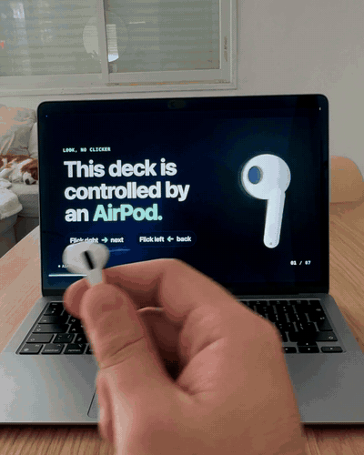

# AirClicker

**Turn an AirPod into a presentation clicker.** Hold one AirPod and flick your wrist: right for the next slide, left to go back.

<p align="center"></p>

AirClicker is a tiny macOS menu bar app. It reads the motion sensors in your AirPods, spots a quick wrist flick, and presses the arrow key for you, so it works with Keynote, PowerPoint, Google Slides, PDFs, or any deck that moves with the arrow keys. No extra hardware, no phone app.

It started as a 15 minute build with [Claude Code](https://claude.com/claude-code) on the morning of a presentation, and was then tuned on 159 logged test flicks.

## Install it with an AI agent

Not comfortable with the terminal? Paste this into Claude Code (or any coding agent that can run commands on your Mac) and it will set everything up for you:

```text
Install AirClicker on my Mac from https://github.com/Harelzx/airclicker. It is a small macOS menu bar app that turns an AirPod into a presentation clicker.

1. Check that I'm on macOS 14 or later (`sw_vers`). If not, stop and tell me it won't run.
2. Check that the Xcode Command Line Tools are installed (`xcode-select -p`). If they're missing, run `xcode-select --install`, tell me to click Install in the window that opens, and wait until I confirm it finished.
3. Clone the repo into ~/airclicker (or `git pull` there if it already exists), then run `./build.sh` inside it. If the build fails, show me the error and fix it before going on.
4. Copy build/AirClicker.app to /Applications (replace any older copy) and open it.
5. Walk me through the two permissions macOS will ask for, one at a time, and wait for me after each:
   - Motion & Fitness: click Allow.
   - Accessibility: click the AirPod icon in the menu bar, choose "Grant Accessibility permission…", then turn AirClicker on in System Settings → Privacy & Security → Accessibility.
6. Tell me how to use it: connect my AirPods to the Mac, turn on "Presentation mode" in the menu, check that the menu shows "Motion sensors: receiving ●", hold one AirPod and flick right for the next slide, left for the previous one.
7. Offer to open demo/index.html from the repo in my browser so I can practise.
```

## Requirements

- macOS 14 or later
- AirPods with motion sensors (the ones that support head tracking: AirPods Pro, AirPods 3rd gen or later, AirPods Max)
- Xcode Command Line Tools for `swiftc` (`xcode-select --install`)

## Install

```sh
git clone https://github.com/Harelzx/airclicker.git
cd airclicker
./build.sh
open build/AirClicker.app
```

The first time it runs, macOS asks for two permissions:

1. **Motion & Fitness**, to read the AirPods sensors. Click Allow.
2. **Accessibility**, to press the arrow keys. Choose *Grant Accessibility permission…* in the menu, then turn AirClicker on in System Settings → Privacy & Security → Accessibility.

## Use it

1. Connect your AirPods to the Mac.
2. Click the AirPod icon in the menu bar and turn on **Presentation mode**. The menu should show *Motion sensors: receiving ●*.
3. Take one AirPod out, hold it between your fingers, and open your slides.
4. **Flick right → next slide. Flick left → previous slide.** A quick, wide flick, like turning a key.

Want to try it before your real talk? Open [`demo/index.html`](demo/index.html) in a browser and flick through the demo deck from the video.

### Menu options

| Option | What it does |
|---|---|
| Presentation mode | Turns listening on or off |
| Sensitivity | Low for very sharp flicks only, High for lighter flicks |
| Reverse direction | Swaps next and back |
| Test: send Next in 3 seconds | Checks the key press works without the AirPods |

### Tips

- Flick from the wrist, quick and wide. A slow turn is ignored on purpose, so normal hand movement while you talk never changes a slide.
- Right flicks are often weaker than left ones. If they get missed, set Sensitivity to High, or turn on **Reverse direction** so your stronger flick moves forward.
- Wait for the slide to change before the next flick: the swing back to center is ignored for about half a second.
- Turn off **Presentation mode** when your talk is over. While it's on, AirClicker plays silent audio to keep the AirPods connected, which uses AirPods and Mac battery.

## Privacy

AirClicker has no network code. Motion data stays on your Mac and is used only to detect flicks; the only thing it writes is a local log of flick timings in `~/Library/Logs/AirClicker.log`, capped at about 2 MB (older entries move to `AirClicker.old.log`, which is replaced each time).

## How it works

- `CMHeadphoneMotionManager` streams the AirPod's gyroscope and gravity at about 50 Hz.
- The rotation is projected onto gravity, so only the turn around the vertical axis counts. It doesn't matter how you hold the AirPod.
- A turn is a flick only when it is **fast** (above ~370°/s for two samples in a row), **wide** (past 75°) and **mostly horizontal** (twisting or lifting your hand is ignored).
- The swing back to center right after a flick is ignored, and so is the small pull back people make before flicking the other way.
- A flick posts a Right or Left Arrow key event with `CGEvent`.
- A silent audio loop keeps the AirPods connection, and the motion stream, alive while the AirPod is out of your ear.

All of it is one Swift file: [`Sources/AirClicker/main.swift`](Sources/AirClicker/main.swift).

## Troubleshooting

- **"Motion sensors: no data"**: make sure the AirPods are the Mac's current audio output, then toggle Presentation mode off and on.
- **Slides don't move**: the presentation app has to be the active window. Click on it once. Also check the Accessibility permission.
- **Asked for Accessibility again after rebuilding**: the default build is signed ad hoc, so macOS treats each build as a new app. Remove the old entry in Accessibility and add the new one, or sign with your own Apple Development identity (see the top of `build.sh`).
- **Flicks are missed or too eager**: change Sensitivity. Every flick is logged with its speed and angle in `~/Library/Logs/AirClicker.log`, which helps when tuning.

## License

MIT. See [LICENSE](LICENSE).
